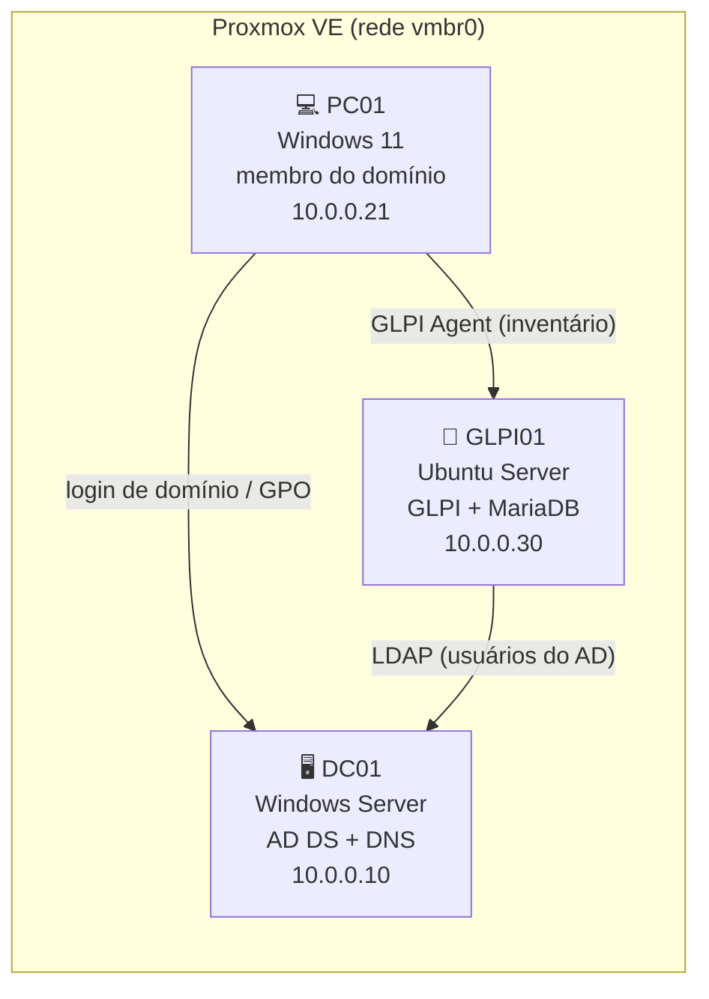

# 🏢 Homelab: Active Directory + GLPI no Proxmox

> Laboratório de **infraestrutura de suporte de TI** montado do zero: domínio Active Directory com políticas de grupo, estação Windows ingressada no domínio e **service desk com GLPI** integrado ao AD, com inventário automático e chamados.


---

## 🎯 Objetivo

Praticar, num ambiente meu, as tarefas que mais aparecem em vagas de Suporte e Help Desk:

- Criar e administrar um **domínio Active Directory** (usuários, grupos, OUs)
- Aplicar **GPOs** (políticas de grupo) nas estações
- Ingressar máquinas no domínio e resolver problemas de **DNS**
- Operar um **service desk** com abertura, atendimento e fechamento de chamados
- Fazer **inventário automático** das máquinas
- **Automatizar** tarefas repetitivas com PowerShell

---

## 🗺️ Arquitetura



| VM | Sistema | Função | vCPU | RAM | Disco | IP |
|---|---|---|:-:|:-:|:-:|---|
| DC01 | Windows Server (avaliação) | Controlador de domínio, DNS | 2 | 4 GB | 50 GB | 10.0.0.10 |
| PC01 | Windows 11 Enterprise (avaliação) | Estação do "usuário" | 2 | 4 GB | 64 GB | 10.0.0.21 |
| GLPI01 | Ubuntu Server LTS | Service desk e inventário | 2 | 2 GB | 20 GB | 10.0.0.30 |

> Ajuste os IPs para a faixa da sua rede. O domínio do laboratório é **`lab.internal`** (NetBIOS **`LAB`**). O sufixo `.internal` é reservado para redes privadas e evita conflitos que o `.local` causa.

---

## 📋 Requisitos

- Um computador **seu** com Proxmox VE (ou VirtualBox/Hyper-V, os passos mudam pouco), com **16 GB de RAM** ou mais
- ISO do **Windows Server** em versão de avaliação (Microsoft Evaluation Center)
- ISO do **Windows 11 Enterprise** em versão de avaliação (Microsoft Evaluation Center)
- ISO do **Ubuntu Server LTS**
- ISO dos **drivers VirtIO** (para o Windows reconhecer disco e rede no Proxmox)

> ⚠️ **Monte este laboratório no seu próprio equipamento.** Não use o Proxmox nem a rede da empresa sem autorização, e não coloque prints, nomes ou dados do trabalho neste repositório.

> ℹ️ O Windows Server de avaliação precisa ser ativado pela internet nos primeiros 10 dias, senão desliga sozinho, e expira em 180 dias.

---

## ✅ Roteiro

Marque cada etapa conforme for concluindo. Para cada uma, salve prints em `docs/img/` e escreva o que deu errado e como resolveu. **É isso que transforma o laboratório em portfólio.**

### Etapa 1: Preparar o Proxmox
- [ ] Enviar as ISOs para o storage `local` (Datacenter → local → ISO Images → Upload)
- [ ] Criar as 3 VMs da tabela. Nas VMs Windows: tipo de máquina **q35**, disco **VirtIO SCSI**, rede **VirtIO** e um segundo drive de CD com a ISO VirtIO
- [ ] Na instalação do Windows, clicar em **Carregar driver** e apontar para a pasta `vioscsi` da ISO VirtIO
- [ ] Depois de instalar, rodar o `virtio-win-guest-tools.exe` para instalar rede e QEMU Guest Agent

### Etapa 2: Controlador de domínio (DC01)
Configure IP fixo e DNS apontando para ele mesmo, depois rode no PowerShell como administrador:

```powershell
# Nome do servidor e IP fixo
Rename-Computer -NewName "DC01" -Restart
New-NetIPAddress -InterfaceAlias "Ethernet" -IPAddress 10.0.0.10 -PrefixLength 24 -DefaultGateway 10.0.0.1
Set-DnsClientServerAddress -InterfaceAlias "Ethernet" -ServerAddresses 127.0.0.1

# Instala o AD DS e cria a floresta lab.internal (o servidor reinicia no fim)
Install-WindowsFeature AD-Domain-Services -IncludeManagementTools
Install-ADDSForest -DomainName "lab.internal" -DomainNetbiosName "LAB" -InstallDns
```

- [ ] Conferir em **Usuários e Computadores do Active Directory** (`dsa.msc`) que o domínio existe
- [ ] Criar um **encaminhador DNS** (DNS Manager → Encaminhadores → `1.1.1.1` ou `8.8.8.8`) para as VMs acessarem a internet

### Etapa 3: Estrutura do AD com PowerShell
Crie as OUs e importe usuários a partir de um CSV. Isso simula o "onboarding" de funcionários novos, uma das tarefas mais comuns do suporte.

`scripts/usuarios.csv`
```csv
Nome,Sobrenome,Usuario,Departamento
Ana,Souza,ana.souza,Financeiro
Bruno,Lima,bruno.lima,Financeiro
Carla,Mendes,carla.mendes,RH
Diego,Alves,diego.alves,TI
```

`scripts/criar-usuarios.ps1`
```powershell
# Cria uma OU por departamento e importa os usuários do CSV
Import-Module ActiveDirectory
$base = "DC=lab,DC=internal"
$senha = Read-Host "Senha inicial dos usuários" -AsSecureString

New-ADOrganizationalUnit -Name "Empresa" -Path $base -ErrorAction SilentlyContinue
$raiz = "OU=Empresa,$base"

Import-Csv "$PSScriptRoot\usuarios.csv" | ForEach-Object {
    $ou = "OU=$($_.Departamento),$raiz"
    if (-not (Get-ADOrganizationalUnit -Filter "DistinguishedName -eq '$ou'")) {
        New-ADOrganizationalUnit -Name $_.Departamento -Path $raiz
        New-ADGroup -Name "GRP-$($_.Departamento)" -GroupScope Global -Path $ou
    }
    New-ADUser -Name "$($_.Nome) $($_.Sobrenome)" -GivenName $_.Nome -Surname $_.Sobrenome `
        -SamAccountName $_.Usuario -UserPrincipalName "$($_.Usuario)@lab.internal" `
        -Department $_.Departamento -Path $ou -AccountPassword $senha `
        -ChangePasswordAtLogon $true -Enabled $true
    Add-ADGroupMember -Identity "GRP-$($_.Departamento)" -Members $_.Usuario
    Write-Host "Criado: $($_.Usuario) em $($_.Departamento)"
}
```

- [ ] Rodar o script e conferir os usuários no `dsa.msc`
- [ ] Praticar as tarefas do dia a dia: **resetar senha**, **desbloquear conta**, **desativar usuário que saiu da empresa**

```powershell
Set-ADAccountPassword -Identity ana.souza -Reset -NewPassword (Read-Host -AsSecureString "Nova senha")
Unlock-ADAccount -Identity ana.souza
Disable-ADAccount -Identity bruno.lima
Search-ADAccount -LockedOut   # lista contas bloqueadas
```

### Etapa 4: Estação no domínio (PC01)
- [ ] IP fixo `10.0.0.21` com **DNS apontando para o DC01 (10.0.0.10)**. Sem isso, o ingresso no domínio falha, e esse é um dos erros mais comuns no suporte real
- [ ] Ingressar no domínio:

```powershell
Rename-Computer -NewName "PC01"
Add-Computer -DomainName "lab.internal" -Credential LAB\Administrador -Restart
```

- [ ] Mover o PC01 para uma OU `Computadores` e fazer login com `ana.souza`

### Etapa 5: GPOs (políticas de grupo)
Crie no **Gerenciamento de Política de Grupo** (`gpmc.msc`) e vincule às OUs:
- [ ] **Papel de parede padrão** da empresa
- [ ] **Bloquear o Painel de Controle** para usuários comuns
- [ ] **Mapear uma pasta de rede** por departamento (crie um compartilhamento `\\DC01\Financeiro`)
- [ ] **Política de senha** e **bloqueio após 5 tentativas**
- [ ] Testar no PC01 com `gpupdate /force` e conferir com `gpresult /r`

### Etapa 6: GLPI (GLPI01)
- [ ] Instalar o Ubuntu Server com IP fixo `10.0.0.30`
- [ ] Instalar Apache, PHP e MariaDB. Confira antes a versão de PHP exigida pela versão do GLPI que você vai baixar, nos pré-requisitos da documentação oficial (glpi-install.readthedocs.io)

```bash
sudo apt update && sudo apt upgrade -y
sudo apt install -y apache2 mariadb-server php libapache2-mod-php \
  php-{apcu,cli,common,curl,gd,intl,ldap,mbstring,mysql,xml,zip,bz2,bcmath}

# Banco de dados e usuário do GLPI
sudo mysql -e "CREATE DATABASE glpi CHARACTER SET utf8mb4 COLLATE utf8mb4_unicode_ci;"
sudo mysql -e "CREATE USER 'glpi'@'localhost' IDENTIFIED BY 'TroqueEstaSenha';"
sudo mysql -e "GRANT ALL PRIVILEGES ON glpi.* TO 'glpi'@'localhost'; FLUSH PRIVILEGES;"
```

- [ ] Baixar a versão estável mais recente em **github.com/glpi-project/glpi/releases**, extrair em `/var/www/glpi` e apontar o Apache para a pasta `public`
- [ ] Concluir a instalação pelo navegador (`http://10.0.0.30`), **trocar as senhas dos usuários padrão** e apagar o `install/install.php`

### Etapa 7: GLPI integrado ao AD + inventário + chamados
- [ ] **LDAP:** Configurar → Autenticação → Diretórios LDAP → adicionar o DC01 (`10.0.0.10`, porta 389, base `DC=lab,DC=internal`). Importar os usuários do AD
- [ ] **Inventário:** instalar o **GLPI Agent** no PC01 apontando para o GLPI. O computador deve aparecer em Ativos com hardware e software
- [ ] **Categorias de chamado:** Acesso/Senha, Hardware, Software, Rede, Impressora
- [ ] **SLA:** por exemplo, 4 horas para atender e 24 horas para resolver
- [ ] **Simular 10 chamados** como se fossem dos usuários (Ana não consegue entrar, Bruno sem acesso à pasta, etc.) e resolver cada um no laboratório, registrando a solução
- [ ] Criar **3 artigos na Base de Conhecimento** do GLPI com as soluções mais comuns

### 🌟 Bônus
- [ ] Instalar um **agente Wazuh** no DC01 e acompanhar os eventos de login com falha
- [ ] **Backup** das VMs com o Proxmox Backup Server
- [ ] Script PowerShell que gera um **relatório de usuários inativos** há mais de 30 dias:

```powershell
Search-ADAccount -AccountInactive -TimeSpan 30.00:00:00 -UsersOnly |
  Select-Object Name, SamAccountName, LastLogonDate |
  Export-Csv ".\inativos.csv" -NoTypeInformation -Encoding UTF8
```

---

## 📁 Estrutura do repositório

```text
homelab-ad-glpi/
├── README.md            este roteiro
├── scripts/
│   ├── usuarios.csv     usuários de exemplo
│   └── criar-usuarios.ps1
└── docs/
    ├── img/             prints de cada etapa
    └── problemas.md     erros que apareceram e como resolvi
```

---

## 🧠 O que eu aprendi

> Preencha conforme for avançando. Recrutadores leem esta parte.

- 
- 
- 

---

<sub>Laboratório de estudo de **Pedro Henrique Margutti** · [LinkedIn](https://www.linkedin.com/in/pedro-henrique-margutti-158696382/) · [GitHub](https://github.com/pedromargutti)</sub>
